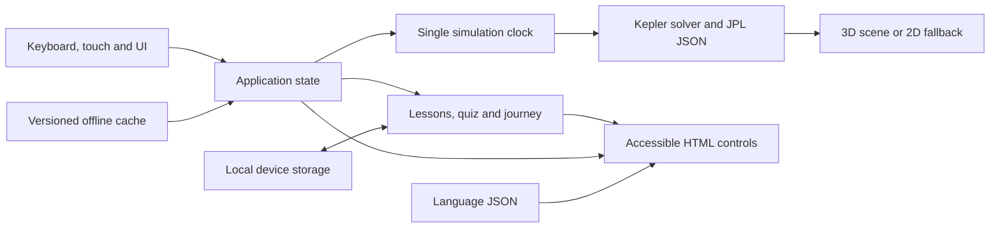

# Architecture

Orbit uses vanilla JavaScript ES modules, Three.js and Vite. Existing scene,
UI and tour logic was moved and extended rather than replaced by a framework.

## Modules

- `src/core`: rendering, controls, simulation clock, quality detection, offline registration, 2D fallback.
- `src/data`: physical reference values, sourced orbital elements and lesson sequences.
- `src/ui`: templates and icons. HTML buttons remain available independently of ray picking.
- `src/modes`: guided video, quiz, teacher activities and Scale Journey.
- `src/i18n`: English, Tamil and Hindi dictionaries and DOM translation adapter.
- `src/utils`: orbital calculations, dates, storage, assets and validated share URLs.

## Simulation clock

`TimeController` owns the start Julian date and elapsed simulated days. Camera
easing uses render seconds; planetary motion uses days since J2000. Both normal
playback and the video advance the same clock. Video's chapter time is presentation
time, not a second planetary clock. Hidden tabs do not advance the simulation.
The date range is bounded to the sourced JPL table's 1800–2050 interval.

Calendar inputs represent midnight UTC. The current-date default starts at the
current instant. UTC is approximated as TDB for this classroom model; no time-scale
correction or light-time/aberration correction is applied to planet coordinates.

## Orbital model

JPL Table 1 supplies six elements and six rates per Julian century. The solver
reduces mean anomaly, solves Kepler's equation with Newton iteration, and rotates
orbital-plane coordinates into J2000 ecliptic coordinates. Three.js uses
`(X, Z, -Y)` so positive world Y is ecliptic north. Distances use all three axes.
Earth is represented by the Earth–Moon barycenter. Surface spin phases and moon
positions remain illustrative. Tests compare six positions with independent
DE441 Horizons fixtures. The measured Neptune J2000 discrepancy is about
0.00735 AU; this app must not be described as an exact ephemeris.

## Scale mapping

Compressed mode multiplies each planet's physical orbit by a planet-specific
factor, preserving its ellipse and inclination while bringing outer planets
closer. Display body sizes are enlarged. True scale uses 11 scene units per AU
for both distances and mean planetary radii. Labels remain readable screen-space
markers; they are not physical-sized objects. Focus adjusts the near plane and
camera distance so a tiny true-scale planet can still be inspected.

Scale Journey freezes the simulation date and moves along the Sun-to-Neptune
direction. Its 60-second presentation does not claim light-speed playback.
The light-time counter uses distance divided by 299,792.458 km/s. Other planets
are not rearranged along that ray. Reduced-motion users start with manual seeking.

## Lite Mode and lifecycle

Device memory and logical CPU hints offer Lite Mode; missing hints do not force
it. A warm-up period and five-second frame sample avoid reacting to initial
shader compilation. The user keeps control and the choice is stored locally.

Standard textures are 768px WebP; Lite textures are 512px. Lite caps DPR to 1,
uses fewer sphere segments and suppresses atmosphere/asteroid effects. Moon
textures are deferred until focus. There is no post-processing chain. Paused,
unchanged scenes skip drawing, while camera interaction still invalidates them.
Rendering resumes without catching up hidden time. Geometry, material and texture
disposal is centralized in the scene's disposal method.

WebGL 2 is required by the installed Three.js. Lite cannot restore unsupported
WebGL hardware; the 2D fallback retains planet selection and learning controls.

## Offline and privacy

The build generates a content-versioned service worker. It caches the small
production asset set before announcing offline readiness. Updates wait for the
user; classroom sessions are not automatically reloaded. URLs are scoped to the
deployment base. No accounts, analytics or server-stored student records are used.
Quiz progress and preferences are stored only in localStorage, with storage
exceptions handled. Source links require a connection and are not cached.

## Validation limits

Browser viewport emulation is not physical-device certification. Performance
records identify the network profile, hardware and measurement method. Translation
coverage and pedagogical wording need classroom review; do not infer approval by
NCERT or CBSE from a curriculum link. See `docs/performance.md` for measurements.
