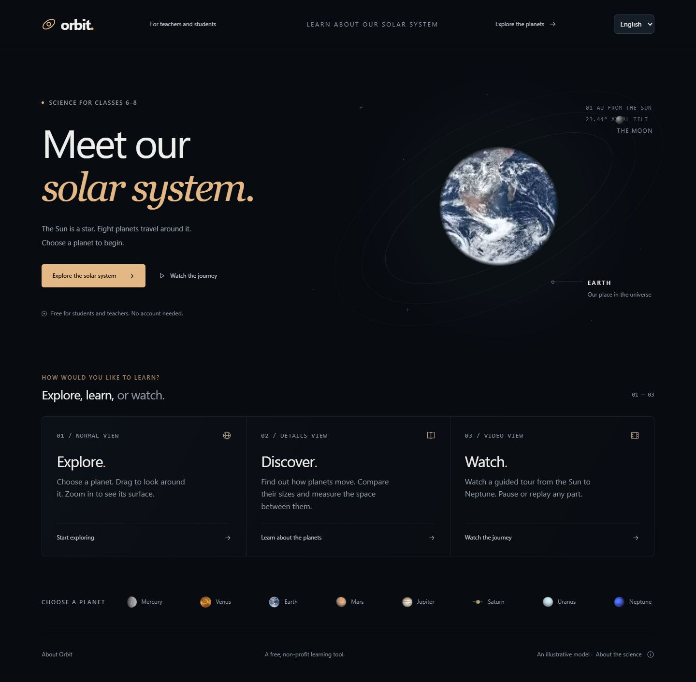
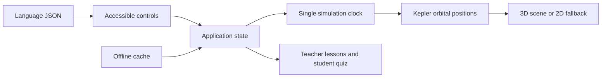

# Orbit — solar system classroom

A free, non-profit learning tool for Classes 6–8. Explore the solar system, explain what changes over time, and guide a class through a short lesson. No accounts or backend are needed.



## Three ways to learn

- **Normal:** select labelled planets, drag to look around, pinch or use buttons to zoom, and pause or resume movement.
- **Details:** read planet facts, compare worlds, change the UTC date, follow days passed, and calculate distances and light-travel time.
- **Video:** watch nine guided 3D chapters with captions, optional device narration, pause, seeking and replay. This does not export a video file.

Teacher activities introduce planets, motion and distance with one question at a time and optional planet focus locking. Student quizzes explain answers and save scores on this device. Scale Journey travels from the Sun toward Neptune, with a live AU and light-time counter. Its 60-second presentation is accelerated; it is not a light-speed simulation.

English, Tamil and Hindi dictionaries supply learning content. Lite Mode reduces graphics costs; a 2D classroom view is available when WebGL cannot start. The production app saves an offline copy and offers installation in supporting browsers. Wait for **Ready to use offline** before disconnecting. The first visit requires internet access.

## Run locally

Requires Node.js 22.14 or later (CI uses Node 24). From the folder containing package.json:

```sh
npm ci
npm run dev
```

For the production/offline version:

```sh
npm run build
npm run preview
```

## Controls

| Task | Control |
| --- | --- |
| Look around | Drag or one finger |
| Zoom | Wheel, pinch, or + / − |
| Pan | Right-drag or two fingers |
| Select | Planet navigator, label, or planet |
| Pause | Playback button; Space outside interactive controls |
| Labels / overview | L / O |
| Close dialog | Escape |

All principal actions have HTML controls for keyboard access. Mobile planet information expands from the bottom sheet. Settings include graphics quality and reduced camera motion.

## Science and curriculum

Planet positions use [NASA/JPL approximate Keplerian elements](https://ssd.jpl.nasa.gov/planets/approx_pos.html), J2000 Table 1, for 1800–2050. Elements, rates, units, citations and limitations are in `src/data/orbits.json`. This is an educational approximation, not a navigation ephemeris. Earth represents the Earth–Moon barycenter; UTC is used without TDB corrections. Surface spin, moons and asteroid visuals remain illustrative.

Compressed view enlarges bodies and shortens spacing. True scale uses physical body radii and AU distances together; labels mark planets too small to see. Distances use the current 3D orbital coordinates, 149,597,870.7 km per AU and 299,792.458 km/s for light.

Lessons reference [NCERT Grade 6 Curiosity, Chapter 12: Beyond Earth](https://ncert.nic.in/textbook/pdf/fecu112.pdf). They can support revision in Classes 7–8. The distance activity is an extension, not a claim of prescribed curriculum coverage. Planet references link to NASA from the app. Tamil/Hindi classroom wording should receive native-speaking teacher review before broad rollout.

## Engineering

Vanilla JavaScript ES modules, Three.js, Vite, a typed physics module, Vitest and Playwright. No UI framework.



See [ARCHITECTURE.md](ARCHITECTURE.md) for scale mapping, clock, caching and Lite Mode decisions. `src/core` contains rendering and lifecycle; `src/data` contains references and lessons; `src/ui` contains templates; `src/modes` contains activities; `src/i18n` contains dictionaries; `src/utils` contains calculations and persistence.

## Verification and performance

```sh
npm run lint
npm run format:check
npm test
npm run build
```

With the development server running, run `npm run test:browser`, `npm run test:recovery`, `node tests/classroom.mjs`, `node tests/languages.mjs` and `node tests/accessibility.mjs`. These use installed Chrome locally and bundled Chromium in CI. Run `node tests/offline.mjs` with the production preview running. `PREVIEW_URL` selects its URL.

`node tests/performance-release.mjs` hosts the build itself and measures a shared 4 Mbps download budget with 150 ms request delay, including service-worker traffic. The final controlled run reached usable 3D in **2.61 s Standard / 2.50 s Lite**, transferred **473 KB / 331 KB** through that point, and recorded about **60 fps** browser cadence on an Intel Iris Xe desktop. Results and limitations are recorded in [docs/performance.md](docs/performance.md). Desktop GPU measurements are not evidence of 60 fps on physical phones or old PCs. Automated accessibility checks supplement, rather than replace, classroom and assistive-technology testing.

## Deployment and purpose

GitHub Actions checks lint, formatting, unit tests, browser flows and offline use before deploying `dist/` from main to GitHub Pages. Configure Pages to use GitHub Actions. The workflow builds with `/3DSolarSystem/`; set `PAGES_BASE` for a different repository name. Development branches do not publish.

The [About page](public/about.html) describes the free educational purpose and local-only progress storage. No analytics or account service is included. Source and external reference links require a connection.

Code is [MIT licensed](LICENSE). Existing images have separate provenance requirements; see [ASSETS.md](ASSETS.md) before redistributing those assets.
